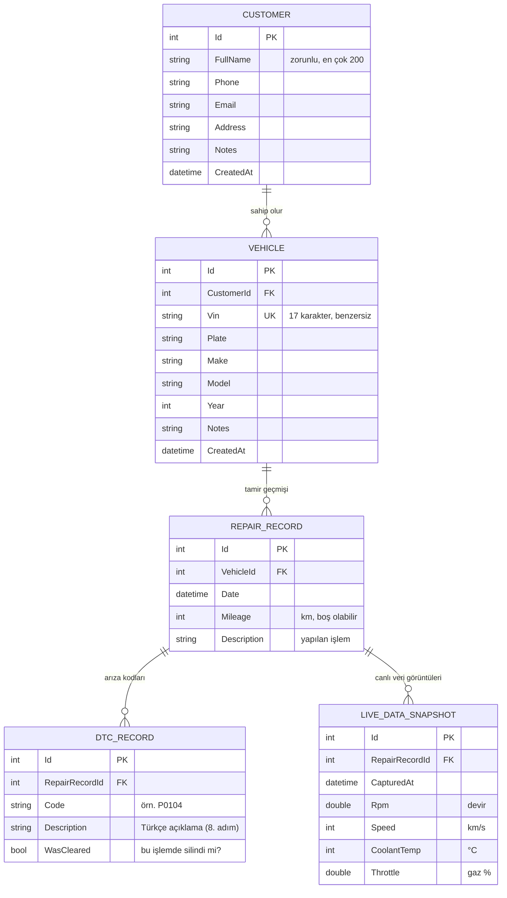

# Veritabanı ER Diyagramı

ObdDiag, verileri bilgisayardaki yerel bir **SQLite** dosyasında saklar
(`%LocalAppData%\ObdDiag\obddiag.db`). Tablolar Entity Framework Core ile yönetilir
(`src/ObdDiag.Data`).

## Diyagram

## Tablolar ve kurallar

| Tablo | Ne tutar? | Önemli kurallar |
|---|---|---|
| **Customer** | Servisin müşterisi | Ad soyad zorunlu. Aracı olan müşteri silinemez. |
| **Vehicle** | Müşterinin aracı | **VIN benzersizdir** (veritabanında *unique index*). VIN 17 karakter olmalı, I/O/Q harfi içermez. Tamir geçmişi olan araç silinemez. |
| **RepairRecord** | Tamir / teşhis kaydı | Yapılan işlem açıklaması zorunlu. Bir araca bağlıdır. |
| **DtcRecord** | Kayıttaki arıza kodu | Tamir kaydı silinirse birlikte silinir (*cascade*). |
| **LiveDataSnapshot** | Teşhis anındaki devir, hız, sıcaklık, gaz | Okunamayan değer boş (null) kalır. Tamir kaydı silinirse birlikte silinir. |

## İlişkiler (1-çok)

- Bir **müşterinin** birden çok **aracı** olabilir; her araç tek müşteriye bağlıdır.
- Bir **aracın** birden çok **tamir kaydı** olabilir.
- Bir **tamir kaydında** birden çok **arıza kodu** ve birden çok **canlı veri görüntüsü** olabilir.

## Silme davranışları (veri kaybını önlemek için)

| İlişki | Davranış |
|---|---|
| Customer → Vehicle | **Restrict**: aracı olan müşteri silinemez |
| Vehicle → RepairRecord | **Restrict**: tamir geçmişi olan araç silinemez |
| RepairRecord → DtcRecord | **Cascade**: kayıtla birlikte silinir |
| RepairRecord → LiveDataSnapshot | **Cascade**: kayıtla birlikte silinir |

## Not

Veritabanı şeması şimdilik uygulama ilk açıldığında otomatik oluşturulur (`EnsureCreated`).
İleride tablo yapısı değişirse, mevcut verileri korumak için EF Core *migration* yöntemine geçilmelidir.
